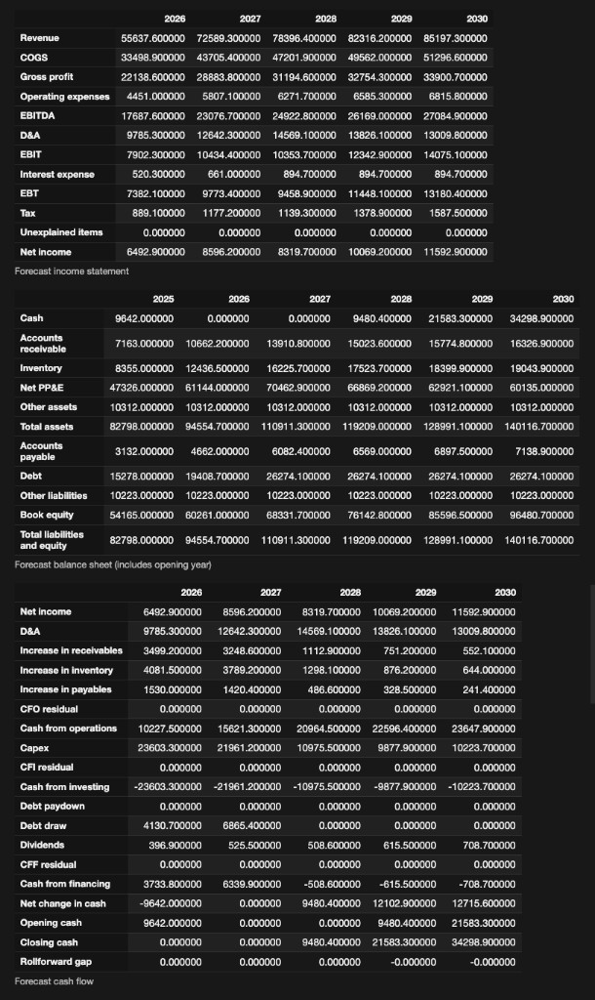
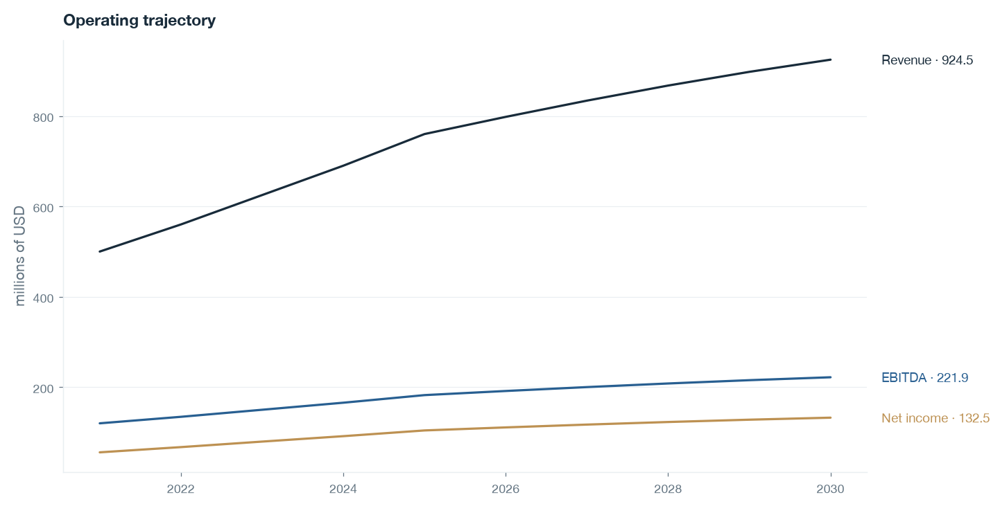
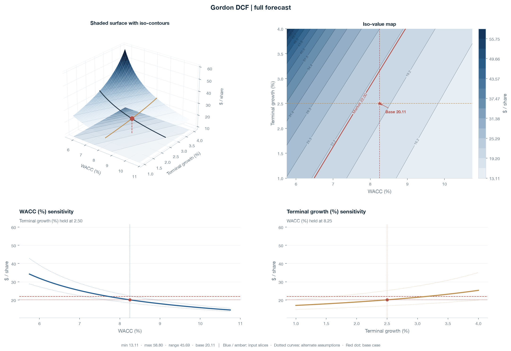
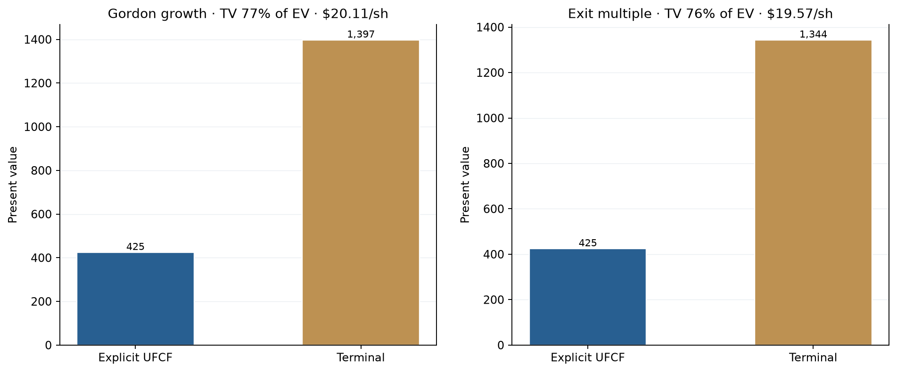
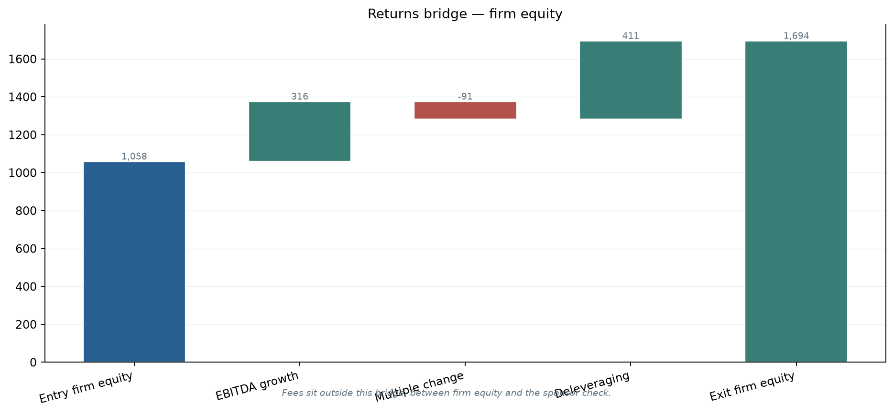
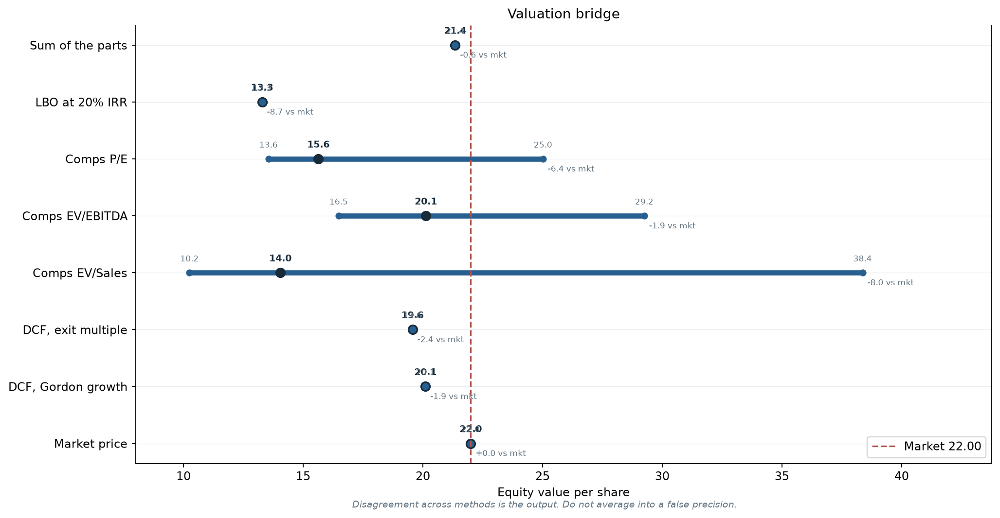
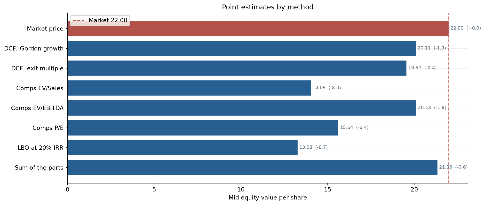

# Valuation models — one case, five lenses

Five classical equity valuation methods share a single active case. Change the company once; every notebook reloads the same equity, peers, segments, and forecast spine. A bridge puts the answers side by side **without averaging them into a fake target price**.

| | |
| --- | --- |
| **Package** | `valuation-models` |
| **Paper** | [docs/integrated_valuation_modeling.md](docs/integrated_valuation_modeling.md) |
| **Stack** | Python 3.11+ · pandas · matplotlib / Plotly · Jupyter |

---

## Why this is one project

Most “valuation packs” are five disconnected spreadsheets. This repo is built around a different claim:

> **Speed comes from reuse. Rigor comes from refusing to hide disagreement.**

```text
cases/active.yaml  →  shared Case
        │
        ├─► 01  Three-statement forecast (operating spine)
        ├─► 02  DCF (intrinsic cash)
        ├─► 03  Trading comps (relative market)
        ├─► 04  LBO (levered buyer affordability)
        ├─► 05  Sum of the parts (segment multiples)
        └─► 06  Bridge (football field — no blend)
```

One picker in any notebook writes `cases/active.yaml`. The next notebook you open is already on the same name.

---

## Gallery

### Linked three-statement forecast

Income, balance sheet, and cash flow roll forward as one closed system. Cash is the residual; the rollforward gap is reported (here: ~0).



<p align="center"><sub>Notebook <code>01_three_statement</code> — forecast IS / BS / CF on the active case</sub></p>

### DCF — cash and sensitivity

Unlevered free cash flow from the same statement engine, with two-way sensitivity on the assumptions that usually dominate value (growth / WACC / exit).

| Cash path | Sensitivity surface | PV split |
| --- | --- | --- |
|  |  |  |

<p align="center"><sub>Notebook <code>02_dcf</code> — UFCF path, terminal / discount sensitivity, and present-value split</sub></p>

### LBO — returns bridge

What a leveraged buyer can pay is not the same question as DCF. Fees, debt paydown, and exit equity are explicit.



<p align="center"><sub>Notebook <code>04_lbo</code> — firm equity → sponsor outcome</sub></p>

### Bridge — where methods agree (and don’t)

Per-share ranges from each lens. The spread is the result — not collapsed into one “target.”

| Football field | Method bars |
| --- | --- |
|  |  |

<p align="center"><sub>Notebook <code>06_valuation_bridge</code> — triangulation without averaging</sub></p>

---

## What each notebook answers

| # | Notebook | Economic question |
| ---: | --- | --- |
| 00 | [`00_active_case.ipynb`](notebooks/00_active_case.ipynb) | Which equity / peers / segments are we modeling? |
| 01 | [`01_three_statement.ipynb`](notebooks/01_three_statement.ipynb) | Do IS, BS, and CF articulate as one system? |
| 02 | [`02_dcf.ipynb`](notebooks/02_dcf.ipynb) | What is equity worth from projected cash under these assumptions? |
| 03 | [`03_comps.ipynb`](notebooks/03_comps.ipynb) | What do peers imply for the latest fiscal earnings? |
| 04 | [`04_lbo.ipynb`](notebooks/04_lbo.ipynb) | What can a levered buyer pay and still clear a return hurdle? |
| 05 | [`05_sum_of_the_parts.ipynb`](notebooks/05_sum_of_the_parts.ipynb) | What are the pieces worth under segment multiples? |
| 06 | [`06_valuation_bridge.ipynb`](notebooks/06_valuation_bridge.ipynb) | Where do the methods agree, and where do they diverge? |

---

## Design choices (intentionally not “smart”)

- **Shared forecast identities** — DCF UFCF, LBO debt capacity, and working-capital paths come from the same statement engine.
- **Live filings are mapped, not rewritten** — gaps are surfaced; cash is not edited to force a historical tie.
- **Net-debt timing is consistent** across DCF and SOTP (latest balance sheet only — forecast cash is already in FCF).
- **Bridge never averages** methods into a single target price.
- **Sensitivity surfaces** make terminal and leverage assumptions inspectable in two dimensions.

Full argument: [docs/integrated_valuation_modeling.md](docs/integrated_valuation_modeling.md).

---

## Quick start

```bash
python3 -m venv .venv
source .venv/bin/activate
pip install -e ".[dev]"
pytest tests -q
jupyter lab notebooks/00_active_case.ipynb
```

Switch the universe in any notebook’s equity picker, or edit:

```yaml
# cases/active.yaml
preset: micron    # sample | micron | apple | microsoft | nvidia | amd | custom
```

Cached statements live under `data/equities/` so re-runs stay fast.

---

## Repository layout

```text
valuation/          # package: statements, DCF, comps, LBO, SOTP, bridge, charts
notebooks/00–06     # one question per notebook
cases/              # active case + presets + universe
data/equities/      # cached statement packs
docs/               # project paper + README assets
scripts/            # import universe, rebuild notebooks, chart preview
tests/              # regression suite for engines + charts
```

---

## Package API (sketch)

```python
from valuation import boot
from valuation.bridge import valuation_bridge
from valuation.dcf import run_dcf
from valuation.statements import forecast_statements

case, unit = boot(picker=False)          # loads cases/active.yaml
forecast = forecast_statements(case)     # linked IS / BS / CF
dcf = run_dcf(case)                      # WACC, UFCF, terminals
bridge = valuation_bridge(case)          # side-by-side per-share ranges
```

Interactive Plotly charts are the notebook default. Set `VALUATION_CHARTS=matplotlib` for static / print figures.

---

## Status

Teaching / research laboratory — not an investment recommendation system. Numbers depend on the active case, mapping quality for live tickers, and explicit assumption choices documented in the paper.
